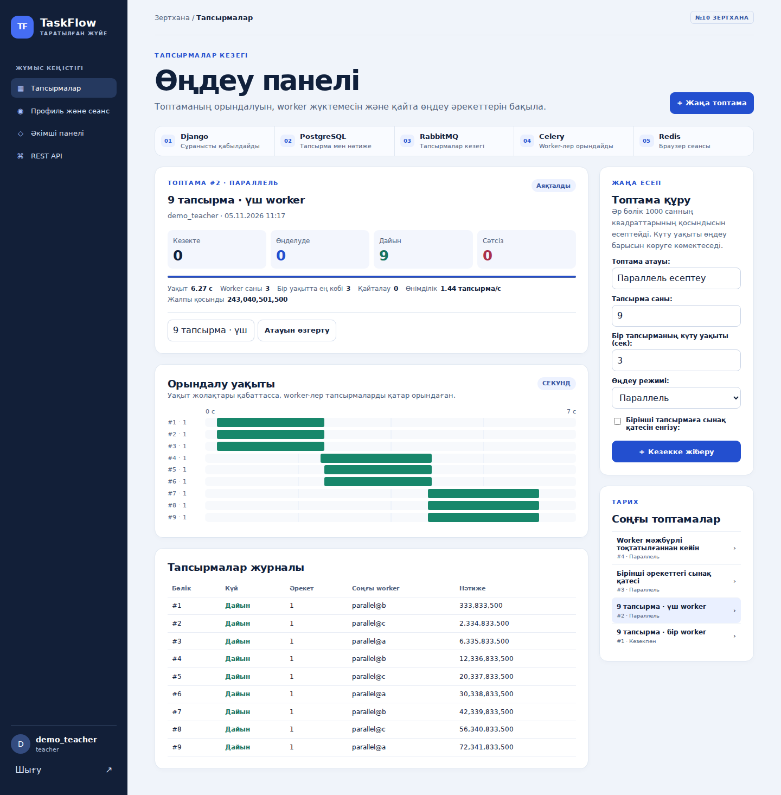

# TaskFlow

TaskFlow is a distributed job-processing prototype. Submit a batch, watch the jobs run in parallel, and inspect each attempt in a dashboard. A failure demo lets you stop a worker and watch a second worker complete the job.



## How it works

1. Django creates a batch and its jobs in one PostgreSQL transaction. The jobs are marked as ready to dispatch.
2. A dispatcher publishes each job to RabbitMQ and clears the dispatch marker after the broker confirms receipt.
3. A Celery worker claims the job and writes the attempt and result to PostgreSQL. The worker locks the job row and checks the attempt number before committing the result.
4. If a worker stops mid-job, the dispatcher requeues the job after its 30-second execution window expires. A job has up to three attempts.

Redis stores browser sessions. Django REST Framework exposes the API, with token and JWT authentication and permissions for students, teachers, and managers.

## Recorded demo

| Mode | Jobs completed | Peak concurrency | Elapsed |
| --- | ---: | ---: | ---: |
| One worker | 9 | 1 | 18.42 s |
| Three workers | 9 | 3 | 6.27 s |

Each job computed a sum of squares and included a two-second simulated wait. Both batches returned the same result, `243040501500`. A separate failure run recorded one worker stopping and another completing the same job. [Recorded run data](evidence/integration.json)

The demo exercises worker recovery. Its PostgreSQL, RabbitMQ, and Redis services each run as a single instance.

## Run locally on Windows

Start Docker Desktop and open PowerShell in the directory that contains `compose.yaml`.

```powershell
Copy-Item .env.example .env
```

Open `.env` and replace the three placeholders with values for your local instance. Use only letters, digits, hyphens, and underscores in `RABBITMQ_PASSWORD` because it is embedded in a broker URL.

```powershell
docker compose up -d --build --scale worker=3
docker compose ps
```

Wait until the `web` service is healthy, then create the demo accounts. Choose a demo password when prompted.

```powershell
docker compose exec web python manage.py demo_accounts
```

Open [TaskFlow on localhost](http://localhost:8000) and sign in as `demo_teacher`. The dashboard interface is in Kazakh.

### Reproduce the demo

1. Create a batch with nine jobs, a two-second wait, and **Кезекпен** (serial) mode.
2. Create another batch with the same inputs and **Параллель** (parallel) mode. Compare the timelines and the totals after both batches finish.
3. To test a retry, check **Бірінші әрекеттегі сынақ қатесі** (inject a failure on the first attempt) before submitting another batch. The timeline shows both the failed attempt and the retry.

Run the automated tests with `docker compose exec web python manage.py test -v 2`. To stop the demo, run `docker compose down`.
